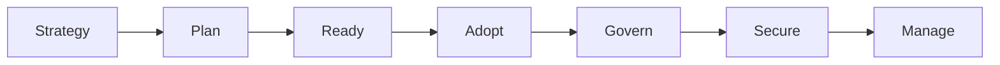
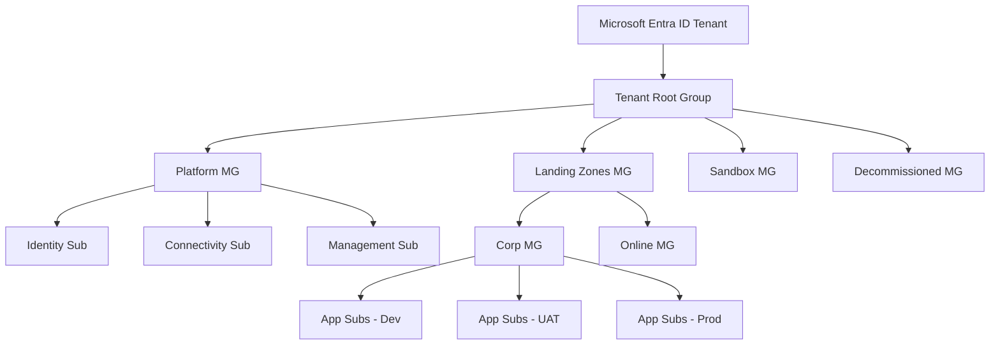
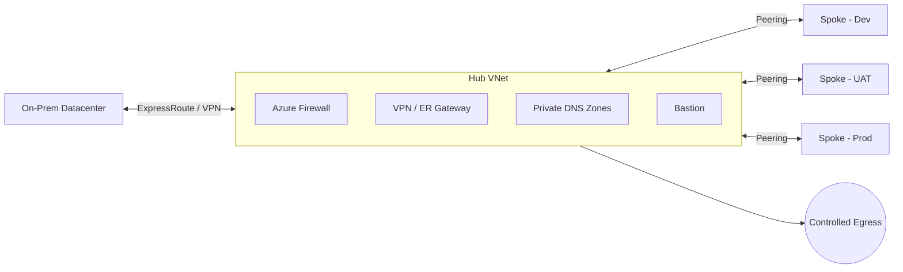
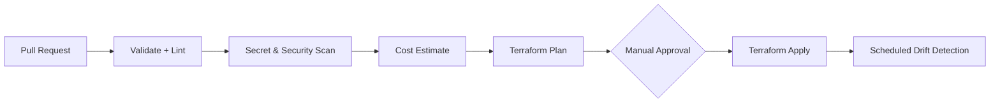
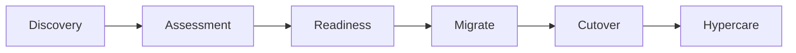

# 🏛️ Enterprise Azure Landing Zone & Cloud Migration Playbook

> A production-grade reference for migrating **100+ applications** across **Dev, UAT and Production** — spanning multiple Azure subscriptions, on-premises datacenters and cloud workloads — using the **Microsoft Cloud Adoption Framework (CAF)**, **Terraform** and **Azure DevOps**.


---

## 📑 Table of Contents

1. [Overview](#-overview)
2. [Design Principles](#-design-principles)
3. [CAF Strategy Coverage](#-caf-strategy-coverage)
4. [Tenant & Management Group Hierarchy](#-tenant--management-group-hierarchy)
5. [Identity & Governance](#-identity--governance)
6. [Hub & Spoke Networking](#-hub--spoke-networking)
7. [Security Layers](#-security-layers)
8. [Terraform Landing Zone Automation](#-terraform-landing-zone-automation)
9. [Azure Repos & DevSecOps Pipelines](#-azure-repos--devsecops-pipelines)
10. [Cloud Migration Approach](#-cloud-migration-approach)
11. [FinOps & Cost Optimisation](#-finops--cost-optimisation)
12. [Backup, DR & High Availability](#-backup-dr--high-availability)
13. [Monitoring & Observability](#-monitoring--observability)
14. [Vendor Management](#-vendor-management)
15. [Transition, KT & Team Upskilling](#-transition-kt--team-upskilling)
16. [Repository Structure](#-repository-structure)
17. [Getting Started](#-getting-started)
18. [Contributing](#-contributing)
19. [Author](#-author)

---

## 🎯 Overview

This repository documents and automates the end-to-end blueprint for an **enterprise-scale Azure landing zone** and a **large-scale migration programme**.

| Item | Scope |
|------|-------|
| Applications | 100+ |
| Environments | Dev, UAT, Production |
| Hosting | Multiple Azure subscriptions + On-premises datacenter + Cloud workloads |
| Connectivity | Hub & Spoke, VPN Gateway, ExpressRoute |
| IaC | Terraform (modular, remote state, policy-gated) |
| CI/CD | Azure Repos + Azure DevSecOps Pipelines |

---

## 🧭 Design Principles

The platform is built to be:

| Principle | How it is achieved |
|-----------|--------------------|
| **Scalable** | Subscription-per-workload, modular Terraform, VMSS / autoscale |
| **Robust & Reliable** | Zone-redundant design, tested failover, defined RTO/RPO |
| **Secure** | Zero Trust, Defender for Cloud, private endpoints, centralized inspection |
| **Portable** | IaC-driven, standard modules, no manual portal drift |
| **Governed** | Management Groups, Azure Policy initiatives, RBAC via groups |
| **Highly Available** | ZRS / GRS, availability zones, secondary region |
| **Cost Optimised** | FinOps reviews, reservations, auto shutdown/start |
| **Backed up** | Policy-enforced Azure Backup with defined retention |
| **Monitored** | Azure Monitor, Log Analytics, alerting & dashboards |
| **Compliant** | Policy-as-code, audit trails, exemption with justification |

---

## 🗺️ CAF Strategy Coverage

The strategy follows the CAF lifecycle:



| CAF Phase | What we cover |
|-----------|---------------|
| **Plan** | Application portfolio, discovery, assessment, business case |
| **Ready** | Landing zone, networking, identity, subscriptions |
| **Adopt** | Migrate (rehost/replatform/refactor), modernise, innovate |
| **Govern** | Azure Policy, cost governance, RBAC, compliance |
| **Secure** | Defender for Cloud, network & identity security, encryption |
| **Manage** | Monitoring, backup, DR, operations baseline |

---

## 🌳 Tenant & Management Group Hierarchy



**Key design decisions**

- Tenant boundary defined using **Microsoft Entra ID** as the single identity plane.
- **Platform subscriptions** (Identity, Connectivity, Management) are separated from **application subscriptions**.
- **Subscription onboarding / offboarding** is standardised and automated (vending process).
- Azure Policy **initiatives** assigned at Management Group level and inherited downward.
- **Policy exemptions** require a documented justification, owner and expiry date.

**Best practices**

- Keep hierarchy shallow (max 3–4 levels), organised by *policy and RBAC needs*, not org chart.
- Never assign permissions to individual users — **groups only**.
- Use a dedicated **Sandbox MG** with relaxed policy and budget caps.
- Move retired subscriptions into **Decommissioned MG** with deny-all policy.

---

## 🔐 Identity & Governance

| Area | Practice |
|------|----------|
| User Management | Entra ID lifecycle, MFA, Conditional Access |
| Group Management | Role-based groups, dynamic membership where applicable |
| RBAC | Least privilege, group-based assignment, scoped at MG/Sub/RG |
| Privileged Access | PIM (just-in-time), break-glass accounts, access reviews |
| Defender | Defender for Cloud (CSPM + CWP) enabled via policy |
| Azure Policy | Initiatives for tagging, allowed regions/SKUs, diagnostics, encryption, backup |

---

## 🌐 Hub & Spoke Networking



**Components**

- **IP Address Management** — central CIDR plan, no overlap with on-prem; on-prem CIDR assessment done *before* any VNet is created.
- **Hub VNet** — Firewall, Gateway, Bastion, shared services, centralised inspection.
- **Spokes** — one per workload/environment, peered to hub.
- **UDRs** — force-tunnel spoke traffic through the firewall.
- **Firewall rules** — deny by default, rule collections per application.
- **Private DNS Zones + Private Endpoints** — PaaS services never exposed publicly.
- **VPN Gateway / ExpressRoute** — hybrid connectivity with redundancy.
- **Controlled Egress** — outbound only via firewall with FQDN/URL filtering.

---

## 🛡️ Security Layers

| Layer | Controls |
|-------|----------|
| **Identity** | MFA, Conditional Access, PIM, managed identities, no shared accounts |
| **Network** | Hub firewall, NSGs, private endpoints, no public IPs by default, DDoS |
| **Governance** | Azure Policy deny/audit, locks, tagging, exemptions with approval |
| **Compute** | Defender for Servers, patching, disk encryption, hardened images |
| **Data** | Encryption at rest and in transit, Key Vault for secrets/keys |

---

## ⚙️ Terraform Landing Zone Automation

**State management**

- Remote state in Azure Storage with **encryption at rest**, versioning and soft delete.
- **Least-privilege** access to state files (separate RBAC per environment).
- State locking enabled; no local state, ever.

**Engineering practices**

- **Reusable modules** with versioning (tagged releases).
- **Linting** (`tflint`, `terraform fmt`, `terraform validate`).
- **Secret scanning** (pre-commit and pipeline).
- **Security scanning** (`checkov` / `tfsec`).
- **Testing** (`terraform test` / Terratest).
- **Cost estimation** (Infracost) on every PR.
- **Manual approvals** before Production apply.
- **Drift detection** via scheduled pipelines.



---

## 🔁 Azure Repos & DevSecOps Pipelines

**Branching**

- **Trunk-based** development with **short-lived feature branches**.
- **PR mandatory**, minimum reviewers enforced, build validation required.
- **Main branch protected** — no direct push, no delete.
- **CODEOWNERS** for platform, network, security modules.

**Pipeline templates**

| Template | Purpose |
|----------|---------|
| Validate & Test | fmt, validate, lint, scans, unit tests |
| Build | Package artifacts / modules |
| Deployment | Plan + environment-gated deploy |
| Apply | Approved Terraform apply |
| Rollback | Revert to last known-good state/version |

Other: **parallel jobs** for independent stacks, **middleware setup** via custom data scripts.

---

## 🚚 Cloud Migration Approach



- **Strategies (6 Rs):** Rehost, Replatform, Refactor, Rearchitect, Retire, Retain.
- **Pre-migration checklist:** dependencies mapped, CIDR validated, backups taken, rollback plan approved, stakeholders signed off.
- **During-migration checklist:** replication health, change freeze, cutover runbook, communication plan.
- **Post-migration checklist:** validation tests, monitoring and backup enabled, DNS cutover, decommission source, cost review.
- **Hypercare:** dedicated support window, defect triage, handover to BAU.

---

## 💰 FinOps & Cost Optimisation

| Area | Action |
|------|--------|
| Idle resources | Weekly review, auto-flag via Advisor / Resource Graph |
| Unattached disks | Scheduled cleanup with approval |
| Oversized compute | Right-size using metrics |
| Log ingestion | Filter noisy tables, set retention tiers |
| VM schedules | Auto shutdown / start for Dev & UAT |
| Reservations | Reserved Instances / Savings Plans for steady workloads |
| Backup retention | Configure per tier, avoid over-retention |
| Governance | Budgets, alerts, mandatory cost tags |

---

## 💾 Backup, DR & High Availability

| Concept | Approach |
|---------|----------|
| Storage redundancy | LRS (dev), ZRS (zonal HA), GRS/GZRS (DR) |
| Compute HA | Availability Zones, **VMSS**, load balancers |
| Regions | **Primary + Secondary** region pairing |
| Targets | Defined **RTO / RPO** per application tier |
| Backup | Azure Backup via policy, tested restores |
| DR | Azure Site Recovery, documented and rehearsed failover |

---

## 📊 Monitoring & Observability

- **Azure Monitor** + **Log Analytics** workspace (central + per-environment strategy).
- Diagnostic settings enforced by Azure Policy.
- Metric, log and activity-log **alerts** with action groups.
- Dashboards / Workbooks for platform and application health.
- Application Insights for APM, with SLO-based alerting.

---

## 🤝 Vendor Management

**Task assignment**

- Scope, Deliverables, Acceptance Criteria, Sprints, Dependencies, Risks, Commercials, Accountability — all captured in the **SOW**.

**Selection**

- **RFI → RFP**, technical evaluation matrix, architecture capability review, commercial proposal comparison.

**Governance**

- Escalation matrix, least-privilege access for vendor staff (time-bound, PIM-based).
- Weekly reviews, retrospective calls, deliverable sign-off.
- **Payment milestones** linked to signed-off deliverables per contract.

---

## 🎓 Transition, KT & Team Upskilling

- Documentation handover with **RACI** matrix.
- Structured **Knowledge Transfer** sessions (recorded, with runbooks).
- Upskilling plan: certifications (AZ-104, AZ-305, AZ-500, AZ-400), internal workshops.
- Senior-level interviews for new initiatives; shadow → reverse-shadow → own model.

---

## 📁 Repository Structure

```text
.
├── README.md
├── docs/
│   ├── architecture/        # HLD, LLD, diagrams
│   ├── governance/          # Policies, RBAC model, exemptions
│   ├── migration/           # Checklists, runbooks, cutover plans
│   ├── finops/              # Cost review templates
│   └── vendor/              # SOW, RFP, evaluation matrix templates
├── terraform/
│   ├── modules/             # Reusable modules (network, policy, mg, etc.)
│   ├── landing-zone/
│   │   ├── management-groups/
│   │   ├── policies/
│   │   ├── connectivity/    # Hub & spoke
│   │   └── identity/
│   └── environments/
│       ├── dev/
│       ├── uat/
│       └── prod/
├── pipelines/
│   ├── templates/           # validate, build, deploy, apply, rollback
│   └── drift-detection.yml
├── scripts/                 # Custom data / middleware setup scripts
└── .azuredevops/            # PR templates, CODEOWNERS
```

---

## 🚀 Getting Started

```bash
# 1. Clone the repository
git clone <your-repo-url>
cd <repo-name>

# 2. Authenticate to Azure
az login
az account set --subscription "<subscription-id>"

# 3. Initialise Terraform with remote state
cd terraform/environments/dev
terraform init

# 4. Review the plan
terraform plan -out=tfplan

# 5. Apply (Prod requires pipeline + manual approval)
terraform apply tfplan
```

**Prerequisites:** Azure CLI, Terraform ≥ 1.5, Git, access to Azure DevOps project, Contributor on target subscription (via group).

---

## 🤲 Contributing

1. Create a short-lived branch from `main` (`feature/<ticket>-<short-name>`).
2. Commit with clear messages (Conventional Commits recommended).
3. Open a PR — pipeline validation and reviewer approval are mandatory.
4. Never commit secrets; pre-commit scanning is enforced.

---

## 👤 Author

**Gunjan Kumar** — DevSecOps Engineer | Azure • Terraform • Azure DevOps

---

> *"Automate everything, govern by policy, secure by default."*